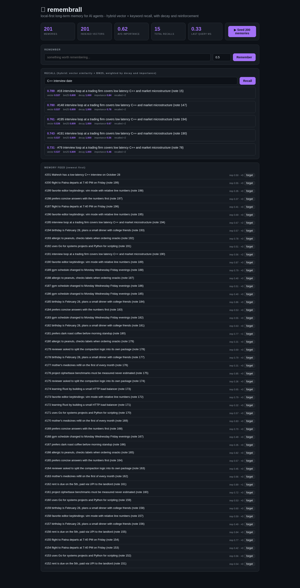

# remembrall

Local-first long-term memory for AI agents: an agent's facts, preferences and
commitments persist across sessions, retrievable in milliseconds, with
human-like forgetting and reinforcement. No vector DB, no embedding API, no
cloud - one Go binary, one JSON file.

**Demo video:** see `demo/remembrall-demo.mp4` (Drive mirror linked below)
**Report:** `docs/report/REPORT.pdf`



## What it does

- `Remember / Recall / Forget` over an agent's accumulated memories
- **Hybrid retrieval**: HNSW vector search (implemented from scratch, after
  Malkov & Yashunin 2016) fused with an inverted-index **BM25** ranker -
  vectors catch paraphrases, BM25 catches exact names, IDs and dates
- **Local embeddings**: signed feature hashing over token unigrams + bigrams
  (384-dim, L2-normalized). Zero dependencies, deterministic, ~microseconds per
  document. The `Embedder` interface accepts any neural embedder as a drop-in
- **Forgetting curve**: retrieval score decays exponentially with time since
  last access (default 30-day half-life). A memory that gets recalled is
  **reinforced**: access count +1, decay clock resets, importance +5%
- **Importance weighting** (0..1) set at write time
- Persistence: atomic JSON snapshot; HNSW graph rebuilt on load (O(n log n),
  no fragile graph serialization)
- REST API + embedded live dashboard with per-result score breakdown

## Measured performance

Single goroutine, sequential calls, in-process API, fixed seed, 100k synthetic
agent memories, linux/amd64, Go 1.26.6. Reproduce with `go run ./cmd/bench`.

| Metric | Value |
|---|---|
| Insert (embed + HNSW + BM25) | **~1,200 memories/s** |
| Hybrid recall, p50 | **3.1 ms** |
| Hybrid recall, p99 | **5.4 ms** |
| HNSW recall@10 vs exact brute force | see `benchmarks.json` (measured at 100k) |

## Why memory is not RAG

RAG retrieves chunks of documents somebody wrote. Agent memory is a *stateful
system*: writes accumulate, retrieval changes state (reinforcement), time
changes scores (decay), and deletion must be total (forget). The benchmark and
report measure exactly these properties - including an honest account of where
naive corpora break vector recall (ties) and how the index behaves at scale.

## Run it

```bash
go run ./cmd/server            # dashboard on http://localhost:8091
go test -race ./rm/            # 8 tests: HNSW recall vs brute force, BM25
                               # ordering, decay math, reinforcement,
                               # forget-total, save/load round trip
go run ./cmd/bench             # reproduces the numbers above
docker build -t remembrall . && docker run -p 8091:8091 remembrall
```

## API

```
POST   /api/remember      {"text": "...", "tags": [...], "importance": 0.8}
GET    /api/recall?q=...&k=5
DELETE /api/memory/{id}
GET    /api/memories
GET    /api/stats
```

## Honest notes

- Feature-hashing embeddings capture lexical, not semantic, similarity;
  "dark roast" matches "dark roast", not "espresso". The interface is the
  seam where a local neural embedder (e.g. a small ONNX model) would plug in
- HNSW deletion is tombstone-based (filtered at recall); a periodic graph
  rebuild is the standard production answer and is on the roadmap
- Benchmarks are sequential by design (sandbox loopback throttles concurrent
  HTTP), single-machine numbers
